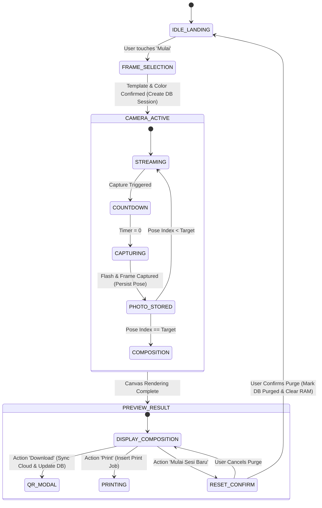

# Product Requirement Document: Photobooth Web Application

## 1. Executive summary and goals

### 1.1 Context
Modern physical photo booths require interactive, responsive user interfaces coupled with automated hardware execution (camera capture, canvas rendering, instant printing, and mobile digital delivery). Traditional photo booth systems frequently rely on heavy, closed-source desktop software that lacks modern UI animation, is difficult to customize with dynamic visual themes, and relies on complex file-sharing procedures for visitors wanting digital copies on their mobile phones.

This project delivers a web-based photobooth kiosk platform featuring a gift-themed animated landing interface, flexible multi-frame selection, automated camera capture sequences with flash and countdown feedback, hardware-ready direct print dispatch, PostgreSQL persistence layer, and temporary cloud storage synchronization for QR-code mobile downloads.

### 1.2 Target outcomes
1. Deliver a responsive kiosk web application that operates locally or in cloud hosting with sub-100 ms UI state transitions.
2. Provide a 60 FPS animated landing page with gift-box interactions and celebratory decorative assets.
3. Support configurable photo layouts: Photo Strip (3 poses), Photo Strip (4 poses), Grid (2x2 poses), and Polaroid (1 pose).
4. Automate camera acquisition via WebRTC `getUserMedia` with real-time mirroring and configurable countdown timers (default 3 seconds).
5. Generate high-resolution composed photo strips at 300 DPI (minimum $1200 \times 1800\text{ px}$ canvas output) entirely in-browser.
6. Provide instant QR code generation referencing a temporary cloud-hosted image URL accessible via cellular data networks.
7. Integrate a persistent relational PostgreSQL database for session history, photo logs, printer status tracking, and automated audit/purge jobs.
8. Provide a backend print spooler endpoint (`/api/print`) capable of dispatching print jobs directly to local kiosk printers without browser confirmation dialogs.
9. Enforce session data privacy by executing complete memory and local cache purges upon session renewal with explicit user confirmation.

---

## 2. Data principles and system architecture

### 2.1 Bounded context and modular hierarchy
The system is divided into four isolated tiers:
* **Presentation Tier (Kiosk UI):** React, Vite, Tailwind CSS, and Framer Motion handling user interaction, WebRTC camera feed, and Canvas image composition.
* **Service Tier (Node.js/Express Backend):** Manages temporary file persistence, cloud storage dispatch (Cloudinary/Supabase API), QR code payload generation, and printer spooler integration.
* **Persistence Tier (PostgreSQL Database):** Centralized relational database engine storing booth sessions, captured frame records, layout configuration metadata, and print spooling queues (accessible locally or via hosted services like Neon / Supabase).
* **External Integration Tier:** Cloud storage provider for mobile downloads, and local OS printer drivers (IPP / CUPS / Windows Spooler).

```
+-----------------------------------------------------------------------------------+
|                                  KIOSK FRONTEND                                   |
|                                                                                   |
|  [Landing & Gift]  -->  [Frame Selector]  -->  [Camera Feed]  -->  [Compositor]   |
|         |                      |                     |                    |       |
|         +----------------------+---------------------+--------------------+       |
|                                         |                                         |
+-----------------------------------------|-----------------------------------------+\
                                          | REST / JSON + MultiPart
                                          v
+-----------------------------------------------------------------------------------+
|                                 NODE.JS BACKEND                                   |
|                                                                                   |
|     +-------------------------+     +---------------------+     +---------------+ |
|     |  Session Storage Engine |     |  Cloud Sync Bridge  |     | Print Spooler | |
|     +-------------------------+     +---------------------+     +---------------+ |
+-------------------|-------------------------|---------------------------|---------+
                    | SQL / Prisma Client     |                           |
                    v                         v                           v
         +--------------------+      [Cloud Object Store]         [Hardware Printer]
         | PostgreSQL Database|     (QR Download Payload)         (Direct USB Print)
         |  - Sessions        |
         |  - Photo Metadata  |
         |  - Print Queue     |
         +--------------------+
```

### 2.2 Entity relations and PostgreSQL database schema
The persistence layer utilizes PostgreSQL dialect with UUID primary keys, JSONB for extensible layout metadata, and explicit cascade constraints:

```sql
-- Enable UUID extension
CREATE EXTENSION IF NOT EXISTS "pgcrypto";

-- Table: booth_sessions
CREATE TABLE booth_sessions (
    id UUID PRIMARY KEY DEFAULT gen_random_uuid(),
    frame_template VARCHAR(32) NOT NULL,
    photo_count SMALLINT NOT NULL DEFAULT 3,
    frame_color VARCHAR(16) NOT NULL DEFAULT '#FFFFFF',
    template_config JSONB NULL,
    status VARCHAR(24) NOT NULL DEFAULT 'ACTIVE', -- ACTIVE, COMPLETED, PURGED
    storage_url VARCHAR(512) NULL,
    client_ip VARCHAR(45) NULL,
    created_at TIMESTAMPTZ NOT NULL DEFAULT CURRENT_TIMESTAMP,
    completed_at TIMESTAMPTZ NULL,
    purged_at TIMESTAMPTZ NULL
);

-- Table: captured_photos
CREATE TABLE captured_photos (
    id UUID PRIMARY KEY DEFAULT gen_random_uuid(),
    session_id UUID NOT NULL REFERENCES booth_sessions(id) ON DELETE CASCADE,
    pose_index SMALLINT NOT NULL,
    file_path VARCHAR(512) NULL,
    image_data_uri TEXT NOT NULL,
    captured_at TIMESTAMPTZ NOT NULL DEFAULT CURRENT_TIMESTAMP
);

-- Table: print_jobs
CREATE TABLE print_jobs (
    id UUID PRIMARY KEY DEFAULT gen_random_uuid(),
    session_id UUID NOT NULL REFERENCES booth_sessions(id) ON DELETE CASCADE,
    copies SMALLINT NOT NULL DEFAULT 1,
    printer_name VARCHAR(128) NOT NULL,
    status VARCHAR(24) NOT NULL DEFAULT 'QUEUED', -- QUEUED, PRINTING, SUCCESS, FAILED
    error_message TEXT NULL,
    dispatched_at TIMESTAMPTZ NOT NULL DEFAULT CURRENT_TIMESTAMP,
    completed_at TIMESTAMPTZ NULL
);

-- Indexes for performance & rapid session lookups
CREATE INDEX idx_sessions_status_created ON booth_sessions(status, created_at DESC);
CREATE INDEX idx_captured_photos_session_pose ON captured_photos(session_id, pose_index);
CREATE INDEX idx_print_jobs_status ON print_jobs(status, dispatched_at);
```

---

## 3. Domain lifecycle flows and algorithmic computations

### 3.1 Session state progression




### 3.2 High-resolution canvas composition algorithm
To guarantee professional print quality at $300\text{ DPI}$, the rendering engine applies coordinate transformations according to paper aspect ratios:

$$\text{Canvas Width} = W_{\text{base}} \times S, \quad \text{Canvas Height} = H_{\text{base}} \times S$$

Where:
* For 4R Print ($4 \times 6\text{ inches}$ at $300\text{ DPI}$): $W = 1200\text{ px}$, $H = 1800\text{ px}$, Scale factor $S \ge 1.0$.
* For Photo Strip ($2 \times 6\text{ inches}$ at $300\text{ DPI}$): $W = 600\text{ px}$, $H = 1800\text{ px}$.

Each captured frame coordinate $(X_i, Y_i, W_{\text{slot}}, H_{\text{slot}})$ is determined by:

$$Y_i = \text{Margin}_{\text{top}} + i \cdot (H_{\text{slot}} + \text{Padding}_{\text{slot}})$$

$$X_i = \text{Margin}_{\text{left}}$$

Aspect ratio cropping ensures no distortion occurs when fitting camera sensor video feed ($16:9$ or $4:3$) into the frame slot ($3:2$ or $1:1$):

$$s_{\text{crop}} = \max\left(\frac{W_{\text{slot}}}{W_{\text{source}}}, \frac{H_{\text{slot}}}{H_{\text{source}}}\right)$$

$$\Delta x = \frac{W_{\text{source}} \cdot s_{\text{crop}} - W_{\text{slot}}}{2 \cdot s_{\text{crop}}}, \quad \Delta y = \frac{H_{\text{source}} \cdot s_{\text{crop}} - H_{\text{slot}}}{2 \cdot s_{\text{crop}}}$$

---

## 4. 2-Level system navigation and development tracker

| Menu Group (Level 1) | Sub-Menu (Level 2) | Functional Description | PRD Reference | Status |
| :--- | :--- | :--- | :--- | :---: |\
| **1. Kiosk Experience** | 1.1 Landing & Gift Hero | Animated entry screen with interactive gift-box trigger | PRD-01 | `Pending` |
| | 1.2 Template Configurator | Layout selector (Strip 3/4, Grid 2x2, Polaroid) and color palette | PRD-02 | `Pending` |
| | 1.3 Camera & Sequence | Mirrored WebRTC video, 3s countdown, flash cue, and audio | PRD-03 | `Pending` |
| | 1.4 Result Preview | Final canvas composite inspection with zoom and frame display | PRD-04 | `Pending` |
| **2. Distribution Services**| 2.1 QR Digital Delivery | Cloud upload orchestration and QR code generation for mobile | PRD-05 | `Pending` |
| | 2.2 Direct Print Spooler | Background dispatch of raw image data to local kiosk printer | PRD-06 | `Pending` |
| | 2.3 Session Purge Guard | Confirmation modal and deterministic memory/disk garbage collector | PRD-07 | `Pending` |
| **3. Database & Persistence**| 3.1 PostgreSQL Store | Session state persistence, print job tracking, and purge automation | PRD-08 | `Pending` |

---

## 5. System modules and detailed feature specifications

### 5.1 Landing page module (`PRD-01`)
* **Interface Elements:** Centered gift box animation container, ambient floating decorations (confetti, starbursts, floating pastel bubbles), dynamic call-to-action button *"Mulai Sekarang"*.
* **Behavior:**
  1. Standby mode runs subtle hovering and pulsing keyframe animations.
  2. Clicking or tapping the button triggers the gift lid opening sequence, fires a confetti particle explosion, and transitions the viewport to the layout selector within 600 ms.

### 5.2 Template configurator module (`PRD-02`)
* **Layout Presets:**
  * `STRIP_3`: 3 vertical photos ($600 \times 1800\text{ px}$ target).
  * `STRIP_4`: 4 vertical photos ($600 \times 1800\text{ px}$ target).
  * `GRID_2X2`: 4 photos arranged in a $2 \times 2$ grid ($1200 \times 1200\text{ px}$ or $1200 \times 1800\text{ px}$).
  * `POLAROID_1`: 1 centered large photo with wide bottom signature margin.
* **Customization Elements:**
  * Palette picker (White, Black, Pastel Pink, Pastel Blue, Cream, Custom Hex).
  * Optional graphic overlay selector (event stickers, date stamps, logo branding).
* **Validation:** Transition to camera creates a pending record in `booth_sessions` table in PostgreSQL.

### 5.3 Camera & capture sequence module (`PRD-03`)
* **Video Source:** WebRTC `navigator.mediaDevices.getUserMedia` requesting `{ video: { width: { ideal: 1920 }, height: { ideal: 1080 } } }`.
* **Visual Presentation:** Mirrored feed with real-time aspect ratio crop guide matching the chosen slot dimensions.
* **Sequence Logic:**
  1. Trigger button starts countdown: 3, 2, 1 with audio ticks.
  2. At 0, opacity flash layer activates for 150 ms, audio shutter sound plays, and video frame is drawn onto a memory canvas.
  3. Frame is saved into the active session array and posted to backend for PostgreSQL logging (`captured_photos`).
  4. System shows pose thumbnail progress (e.g., "Foto 2 dari 4").
  5. Repeat sequence until all $N$ slots are filled, then automatically route to the compositor.

### 5.4 Compositor and preview module (`PRD-04`)
* **Composition Engine:** Client-side HTML5 2D Canvas rendering context.
* **Rendering Steps:**
  1. Clear canvas and fill with chosen frame background color or background graphic template.
  2. Draw each captured photo at target slot coordinates with centering crop parameters.
  3. Render optional frame border, overlay branding, and timestamp.
  4. Export canvas to high-quality data URL (`image/jpeg`, quality: 0.95).
* **Interface:** Full-height preview container displaying the composited photo with three persistent action buttons:
  * `[ Cetak Foto / Print ]`
  * `[ Download Foto (QR) ]`
  * `[ Mulai Sesi Baru ]`

### 5.5 QR code digital delivery module (`PRD-05`)
* **Workflow:**
  1. User clicks *"Download Foto (QR)"*.
  2. Kiosk UI uploads the composited JPEG blob to backend endpoint `/api/photos/upload`.
  3. Backend streams the image to Cloud Storage (Cloudinary/Supabase) and generates a signed public URL.
  4. Backend updates `booth_sessions.storage_url` in PostgreSQL.
  5. Backend returns `{ downloadUrl: "https://..." }`.
  6. Kiosk UI displays a modal with a high-contrast QR code generated from `downloadUrl` and instructional text: *"Scan QR menggunakan kamera smartphone untuk mengunduh foto"*.
  7. Modal includes a close button and auto-close timer (90 seconds).

### 5.6 Direct print spooler module (`PRD-06`)
* **Endpoint Contract:**
  * `POST /api/print`
  * Payload: `{ sessionId: string, copies: number, format: "STRIP" | "4R" }`
* **Workflow:**
  1. Inserts job record into PostgreSQL `print_jobs` with status `QUEUED`.
  2. Backend interfaces with system printing subsystem (via node-printer, CUPS command line, or Windows spooler utility) to write raw printable image directly to the configured default photo printer.
  3. Updates `print_jobs` to `SUCCESS` or `FAILED`.
* **Fallback Mode:** If running in a pure browser/cloud environment without an active local print agent, triggers native `window.print()` with `@media print` CSS rules hiding UI controls and targeting exact paper margins.

### 5.7 Session purge & reset module (`PRD-07`)
* **Safety Confirmation:** Clicking *"Mulai Sesi Baru"* presents a modal dialog:
  * Title: *"Mulai Sesi Baru?"*
  * Description: *"Semua foto pada sesi ini akan segera dihapus permanen. Pastikan Anda telah mengunduh atau mencetak foto sebelum melanjutkan."*
  * Actions: `[ Batal ]` and `[ Ya, Hapus & Selesai ]`.
* **Purge Execution:**
  1. Stop all active camera media streams.
  2. Wipe client state (captured blobs, canvas references, session ID).
  3. Dispatch request to backend `DELETE /api/sessions/:id` which updates `booth_sessions.status = 'PURGED'`, sets `purged_at = CURRENT_TIMESTAMP`, and removes temporary disk buffers.
  4. Navigate smoothly back to `PRD-01` (Landing page).

### 5.8 Database persistence module (`PRD-08`)
* **ORM / Query Engine:** Prisma ORM or Drizzle ORM connecting to PostgreSQL database via connection string `DATABASE_URL`.
* **Connection Pooling:** Configured with connection pooling limit (default: 10 connections) to support high-frequency session transactions without exhausting socket limits.
* **Scheduled Cleanup Daemon:** A background cron job running every 60 minutes marks stale sessions (> 24 hours old) as `PURGED` and deletes associated local temporary files.

---

## 6. User role authorization matrix (RBAC)

| Role | Access Scope | Landing & Capture | Download QR | Direct Print | Admin Settings (Printer / Templates) | DB Audit |
| :--- | :--- | :---: | :---: | :---: | :---: | :---: |\
| **Kiosk Visitor (End-User)** | Kiosk UI Terminal | Full | Full | Full | - | - |
| **Event Staff / Operator** | Kiosk Terminal & Local Host | Full | Full | Full | Review / Configure | Read |
| **System Administrator** | Server & Configuration | Full | Full | Full | Full | Full |

---

## 7. Non-functional requirements (NFR)

1. **Database Query Latency:** Session creation and status update operations in PostgreSQL must execute in $\le 10\text{ ms}$.
2. **Camera Feed Latency:** Local camera preview latency must not exceed $50\text{ ms}$. Video framerate must sustain $\ge 30\text{ FPS}$ (target $60\text{ FPS}$).
3. **Canvas Rendering Throughput:** Canvas assembly of a 4-pose $300\text{ DPI}$ image must complete in $< 400\text{ ms}$ on standard modern browser engines.
4. **QR Generation Latency:** Cloud upload and QR rendering must return in $< 2.5\text{ seconds}$ under a standard broadband or 4G mobile connection.
5. **Data Privacy & Ephemeral Retention:** Captured raw camera frames must be held exclusively in client volatile memory. Final composited images stored on cloud servers must have a strict Time-to-Live (TTL) auto-expiration of 24 hours.
6. **Kiosk Stability:** Application must handle camera disconnects gracefully with an auto-retry and user-facing prompt rather than application crash.

---

## 8. Sub-specification roadmap

* **PRD-01:** Landing Page, Gift Box Motion Component, and Ambient Animations.
* **PRD-02:** Template Selector State Machine & Palette Customizer.
* **PRD-03:** WebRTC Camera Service, Countdown Engine, Flash Trigger, and Pose Buffer.
* **PRD-04:** High-DPI Canvas Compositor & Interactive Preview Screen.
* **PRD-05:** Backend Photo Storage Endpoint & QR Code Modal Presentation.
* **PRD-06:** Print Dispatch Bridge (Direct OS Spooler & Browser Fallback).
* **PRD-07:** Session Life-Cycle Manager & Privacy Purge Confirmation.
* **PRD-08:** PostgreSQL Database Layer with Prisma/Drizzle & Automated Audit Cleanup.
